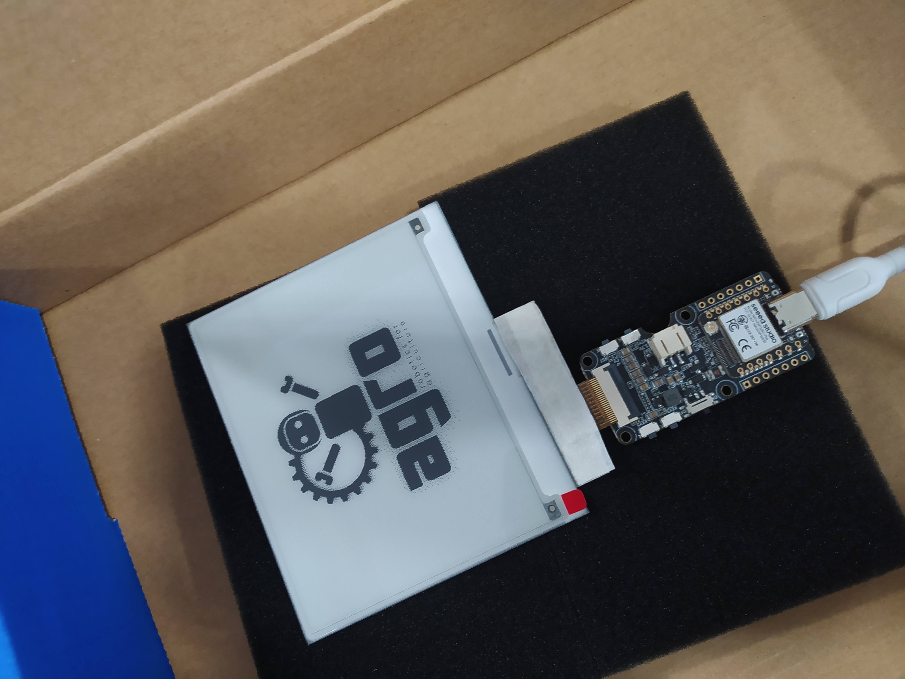

# AGRO E-Paper Display Demo (Seeed Studio XIAO)

Firmware and assets for displaying the **AGRO (Robotics for Agriculture)** logo and handling interactive button triggers on a 400×300 E-Paper display driven by a **Seeed Studio XIAO** microcontroller.

<p align="center">
  
</p>

## Display result

- `assets/logo_400x300_bw.png` is a preview at the panel's 400x300 resolution.
- `src/logo_bitmap.h` contains the matching packed 1-bit bitmap.
- The transparent PNG background becomes white.
- Both green and dark-grey artwork become black because this is a monochrome panel.
- Anti-aliased edges are converted with Floyd-Steinberg dithering.
- The bitmap occupies 15,000 bytes of flash and is declared in PROGMEM.

## Features

* **Custom Bitmap Rendering:** Displays a crisp 400×300 black-and-white bitmap (`logo_bitmap.h`).
* **Interactive Controls:** Supports onboard user buttons (`Key1`, `Key2`, `Key3`) to trigger display refreshes, screen inversion, and state changes.
* **Boot Diagnostics:** Displays initialization status (`EE05 OK`), panel resolution (`400 x 300`), and key press counters upon startup.

## Buttons

- Key1 / GPIO2: black logo on white background.
- Key2 / GPIO3: inverted logo (white on black).
- Key3 / GPIO8: clear the display to white.

The buttons use the EE05's external pull-ups and are active LOW.

## Hardware Requirements

* **Microcontroller:** Seeed Studio XIAO (e.g., XIAO ESP32-C3 / S3 / nRF52840) with ePaper Breakout Board
* **Display:** 4.2" Monochrome E-Paper Panel (400×300 resolution, `EE05` driver)[cite: 2, 4]
* **Cable:** USB-C data cable

## Project Structure

```text
├── assets/
│   └── logo_400x300_bw.png   # Original 400x300 monochrome source image
├── src/
│   ├── driver.h              # E-Paper display pinout and driver configuration
│   ├── logo_bitmap.h         # C-array bitmap generated from the source PNG
│   └── main.cpp              # Main application logic and button handling
├── platformio.ini            # PlatformIO build configuration and dependencies
└── README.md                 # Project documentation
```

## Getting Started

### Prerequisites

* [VS Code](https://code.visualstudio.com/) with the [PlatformIO IDE](https://platformio.org/) extension installed.

### Build & Upload

1. Clone this repository:
   ```bash
   git clone [https://github.com/your-username/your-repo-name.git](https://github.com/your-username/your-repo-name.git)
   cd your-repo-name

2. Build

Open this folder in VS Code with PlatformIO installed, then run:

```powershell
pio run -e ee05_4in2
```

3. Upload:

```powershell
pio run -e ee05_4in2 -t upload
```

4. Serial monitor:

```powershell
pio device monitor -b 115200
```

This project uses Seeed_GFX (the `TFT_eSPI.h` / `EPaper` API), not Seeed_GFX2.
Keep the working PlatformIO Core version and board settings from the project
that previously built successfully.

## Notes

The preview is a 1-bit rendering for the 400x300 panel, not a colour rendering.
Small tagline text and tiny decorative speckles may be less distinct at this
resolution. ePaper full-screen refresh is expected to take noticeably longer
than drawing into the RAM buffer.

